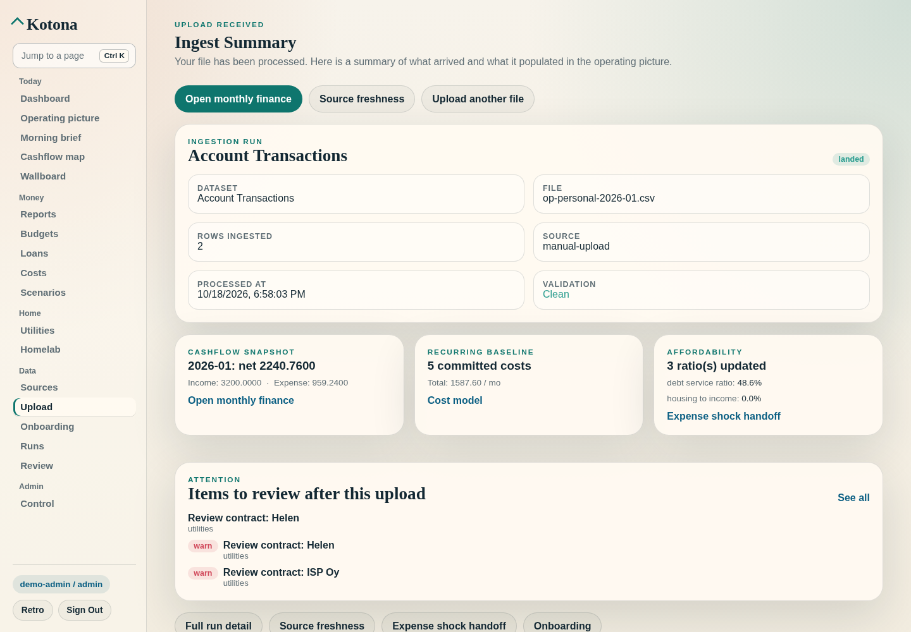
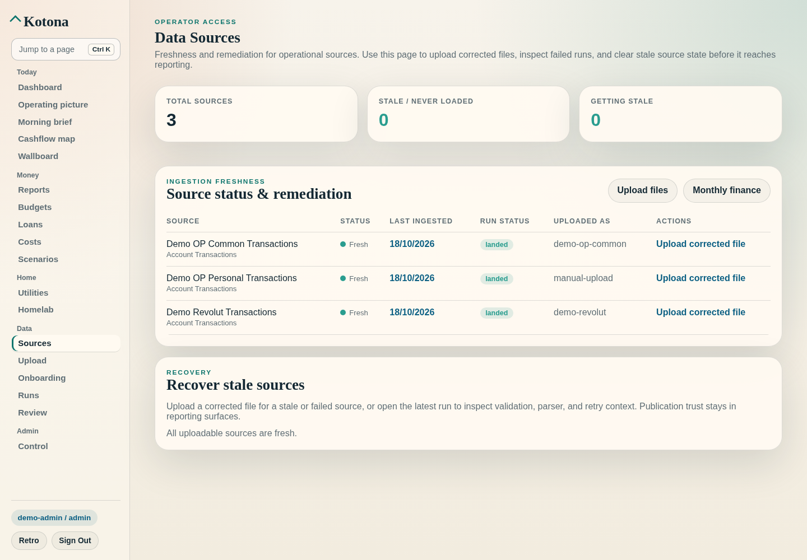
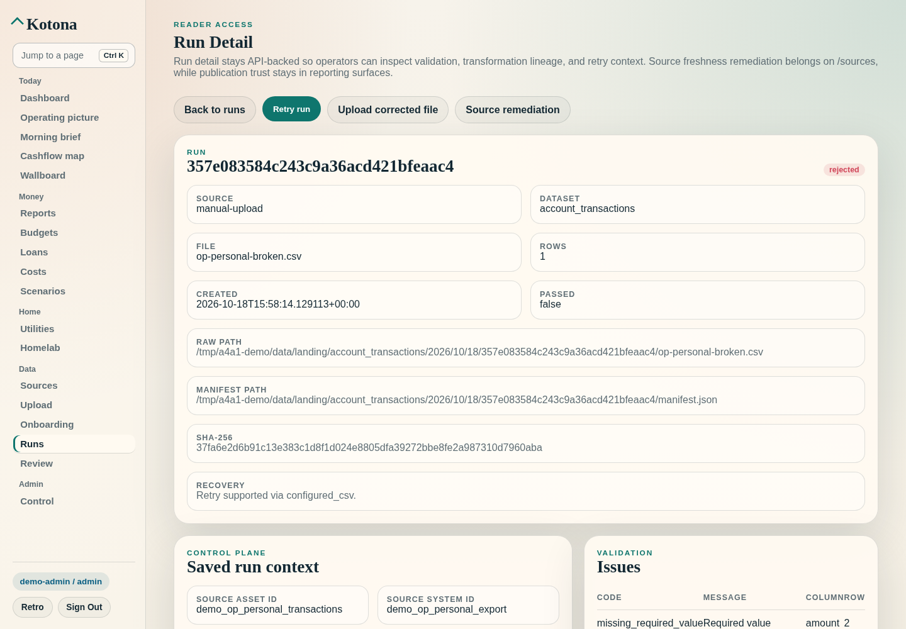
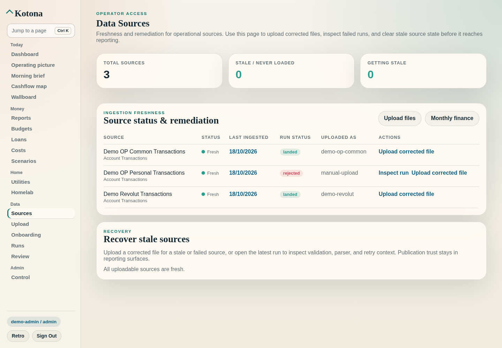
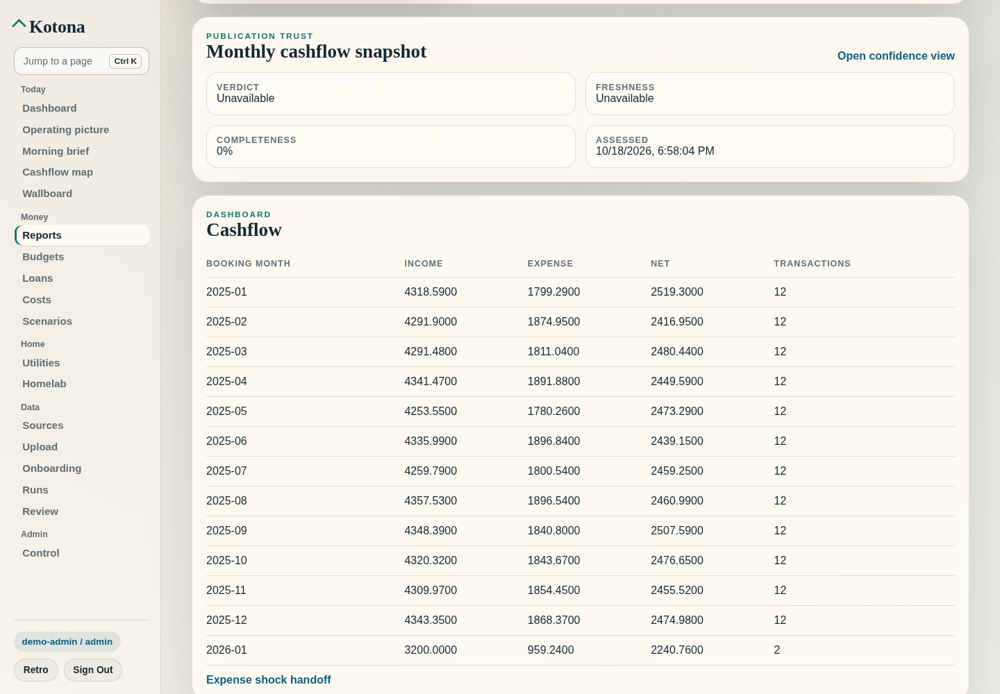
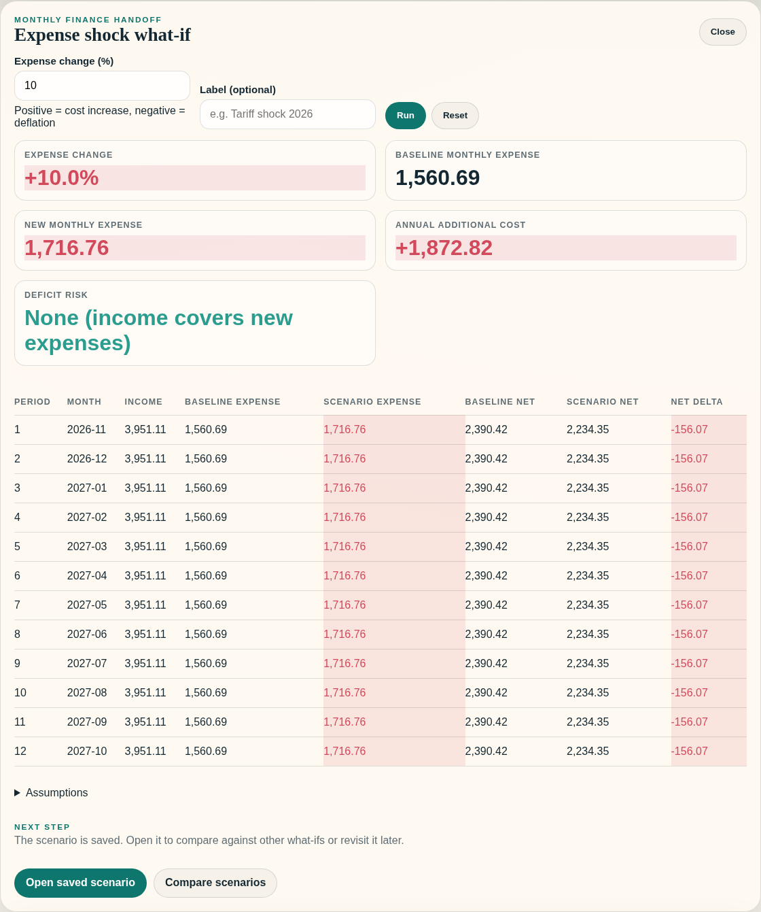
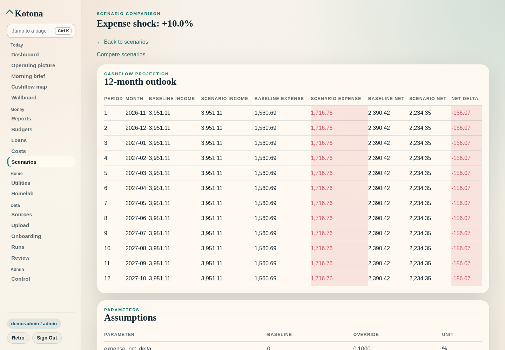
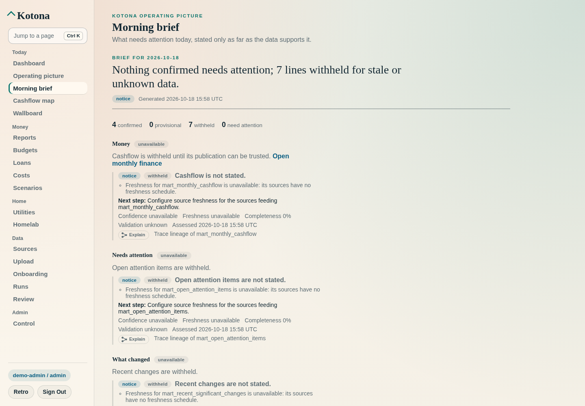

# Operator Walkthrough — the Finance Operator Loop

**Purpose:** Walk the flagship finance loop end to end on synthetic demo data, from a statement upload to an expense-shock decision.
**Time:** About 10 minutes once the demo is seeded.
**Audience:** A first-time operator or developer on a fresh clone.

---

## The loop

The same sequence appears in the README and in this walkthrough. `tests/test_finance_operator_journey_contract.py` keeps the docs and the UI entry points in line with it.

<!-- finance-operator-loop -->
`/upload` → `/ingest-summary/<run_id>` → `/sources` and `/runs` (source freshness and remediation) → `/reports` (monthly finance and publication trust) → `/reports#expense-shock` (baseline, projected, delta) → `/scenarios/<scenario_id>` (saved scenario, next step)

The loop carries two separate trust signals. They are never merged into one status:

- **Source freshness and remediation** describes the inputs. It lives on Sources, Runs and Run detail. The vocabulary is a run status (`landed`, `rejected`, `failed`), the source freshness states (`current`, `due_soon`, `overdue`, `missing_period`, `parse_failed`, `unconfigured`) and a concrete next action.
- **Publication trust** describes what you are reading. It lives on `/reports` and in the morning brief. Its fields are `confidence_verdict` (`trustworthy`, `degraded`, `unreliable`, `unavailable`), `freshness_state` (`current`, `due_soon`, `stale`, `unavailable`), completeness and assessment time.

Fixture-backed proof of the whole loop: `tests/test_finance_operator_loop_e2e.py`. It is synthetic, runs in the fast tier and goes through the same API the web shell calls.

---

## 0. Start a demo instance

The simplest path is Docker: `make first-run`. It builds the images, starts the Compose stack in `local_single_user` mode, seeds the demo bundle and prints the onboarding URL. Sign in with the bootstrap admin from `infra/examples/secrets/auth-local.env.example`.

Without Docker, run the entrypoints directly from the repo root:

```bash
export HOMELAB_ANALYTICS_DATA_DIR=.local/homelab-analytics
export HOMELAB_ANALYTICS_IDENTITY_MODE=local
export HOMELAB_ANALYTICS_SESSION_SECRET=change-me-local-demo-secret

# 1. Seed the committed synthetic bundle (bindings, ingest, promotion)
python -m apps.worker.main seed-demo-data --input-dir infra/examples/demo-data

# 2. Create a local admin so Sources, Runs and Control are reachable
python -m apps.worker.main create-local-admin-user demo-admin '<choose-a-password>'

# 3. API on :8080
python -m apps.api.main

# 4. Web on :8081 (another shell, same environment). The launcher serves
#    the Next.js standalone build, which needs its static assets beside it.
npm --prefix apps/web/frontend ci
npm --prefix apps/web/frontend run build
cp -r apps/web/frontend/.next/static apps/web/frontend/.next/standalone/.next/static
cp -r apps/web/frontend/public apps/web/frontend/.next/standalone/public
python -m apps.web.main
```

Open `http://localhost:8081/login` and sign in as `demo-admin`.

> Identity mode matters. With the `.env.example` default (`HOMELAB_ANALYTICS_IDENTITY_MODE=disabled`) the API refuses every `/control/*` route ("Unsafe admin routes are disabled until authentication is implemented."). Sources then has nothing to show. Use `local` (above) or `local_single_user` for this walkthrough.

`seed-demo-data` registers stable bindings for the three source-shaped account exports: `demo_op_personal_transactions`, `demo_op_common_transactions` and `demo_revolut_transactions`. It ingests and promotes them along with the canonical subscriptions, contract prices, utility bills, budgets and loan repayments. It then prints a JSON summary with each run ID and the reporting row counts. For the committed bundle, `monthly_cashflow` holds 12 rows (2025-01 to 2025-12).

---

## 1. Upload, then land on the ingest summary

1. Open **Upload** (`/upload`).
2. In **Configured CSV upload**, pick the source asset `demo_op_personal_transactions` and choose an OP-format CSV.
   - Re-uploading the seeded file is rejected as a duplicate (HTTP 409), so use a new period: for example, January 2026 rows in the same header layout as `sources/personal account/tapahtumat20250101-20251231.csv`.
3. Click **Upload file**.

A landed upload redirects to `/ingest-summary/<run_id>`:

- The primary action is **Open monthly finance** → `/reports`.
- The other actions are **Source freshness** → `/sources` and **Upload another file**.
- The **Cashflow snapshot** card shows the latest month and also links to `/reports`.
- **Affordability** and the bottom row link to `/reports#expense-shock`.

If the run did not land, the primary action becomes **Inspect run and remediate** → `/runs/<run_id>`.



---

## 2. Source freshness and remediation

**Sources** (`/sources`, operator or admin) lists every registered source asset. Each row shows:

- an age-based status (`Fresh`, `Nd ago`, `Nd ago — stale`, `Never loaded`)
- the latest run status
- the source name the run arrived under
- row actions

The header carries **Upload files** and **Monthly finance** → `/reports`.



To see the degraded branch, upload a file that misses required columns to the same configured asset:

- `/upload` shows the validation issues and **Run recorded: `<run_id>`**.
- **Run detail** (`/runs/<run_id>`) shows the rejected run with **Retry run**, **Upload corrected file** and **Source remediation** → `/sources`.
- **Sources** marks that asset's run `rejected` and offers **Inspect run** and **Upload corrected file**. The upload link lands on the matching card on `/upload`.
- The monthly finance read keeps serving the last good publication. A rejected file never reaches promotion.




The API exposes the same remediation:

| Surface | Field | Actions |
|---|---|---|
| `GET /runs/{run_id}` | `remediation.action`, `remediation.reason` | `retry`, `upload_missing_period`, `fix_contract`, `inspect_binding`, `none` |
| `GET /control/source-freshness` | `freshness_state`, `suggested_action` per source asset | `retry`, `upload_missing_period`, `none` |

| Action | When it appears | What to do |
|---|---|---|
| `retry` | Run failed but the payload is intact, or freshness is `parse_failed` | **Retry run** (`POST /runs/{run_id}/retry`); no re-upload needed |
| `upload_missing_period` | Run rejected or failed without a retryable payload, or freshness is `overdue` / `missing_period` | Correct and re-upload the file for the affected period |
| `fix_contract` | Run rejected for schema or contract violations | Fix the source columns or the dataset contract, then re-upload |
| `inspect_binding` | Run landed but no source asset binding was found | Check the source system, dataset contract and column mapping |

Freshness attributes each run to its own source asset. The three account exports share one dataset, but each row reports its own latest run.

---

## 3. Monthly finance and publication trust on `/reports`

`/reports` is the stable monthly finance read surface, titled **Monthly Finance**. Top to bottom it shows:

1. **Published report views**: renderer discovery for the reporting publications.
2. **Publication trust — Monthly cashflow snapshot**: the verdict, freshness, completeness and assessed time of the `mart_monthly_cashflow` confidence snapshot.
   - Admins read the snapshot directly and get **Open confidence view** → `/control/confidence`.
   - Other roles see the same verdict through the reader-scoped morning brief, with its **Next step** and **Open morning brief**.
3. **Cashflow**: booking month, income, expense, net and transactions, plus **Expense shock handoff**.
4. **Expense shock what-if** (`#expense-shock`), then account balance trend, spend by category, subscription summary, utility cost trend and the income-change what-if.

Budget variance and loan overview live on `/budgets` and `/loans`, not on `/reports`.



**What the demo shows today:** on the local demo (DuckDB warehouse reporting), the monthly cashflow snapshot reads verdict **Unavailable** and freshness **Unavailable**. Completeness is 100%, because the seeded runs are attributed and validated. The screenshot predates the source-asset attribution fix and still shows 0%. The verdict is the honest result of the current trust inputs, not a rendering fault:

- Confidence is computed from source lineage that targets the publication. Each contributing run is attributed to the source asset it was promoted for.
- Freshness is read from that source asset's freshness config.
- The seed configures no source freshness config, so every source reads `unconfigured`.

The morning brief therefore withholds the cashflow line and says why. See *Known limits* below.

---

## 4. Expense shock: baseline, projected, delta

1. On `/reports`, open **Expense shock what-if** → **Run scenario**.
2. Enter an expense change such as `10` (percent) and click **Run**.
3. Read the headline metrics:
   - **Expense change**
   - **Baseline monthly expense** (average of the latest 3 months in the monthly cashflow mart)
   - **New monthly expense**
   - **Annual additional cost**
   - **Months until deficit**, or **Deficit risk: None** when income still covers the shocked expenses
4. Read the 12-month table. Each month shows baseline and scenario expense, baseline and scenario net, and the net delta.

The panel calls `/api/scenarios/expense-shock` and `/api/scenarios/<id>/cashflow` through the web shell's same-origin proxy (`app/api/scenarios/[[...path]]/route.js`). Browser calls therefore work when web and API run on different origins.



---

## 5. Next step: the saved scenario

Every run is saved, so the panel ends with a **Next step**:

- **Open saved scenario** → `/scenarios/<scenario_id>`, which shows the 12-month outlook with baseline and scenario income and expense, then assumptions.
- **Compare scenarios** → `/scenarios/compare?left=<scenario_id>`.
- If the scenario rests on stale inputs, the panel leads with **Refresh stale sources** → `/sources`.



---

## Where else the loop shows up

- **Morning brief** (`/briefing`): its **Money** section is stated only as far as the `mart_monthly_cashflow` verdict allows. It links to **Open monthly finance** → `/reports`, and its **Sources** section links to `/sources` for operators. Withheld lines carry a **Next step** and a lineage drill.
- **Nav rail and command palette** (`Ctrl K`):
  - **Money → Reports** (`/reports`; palette keywords include *cashflow*, *expense shock*, *trust*)
  - **Data → Sources / Upload / Runs**
  - **Money → Scenarios**
  - **Today → Morning brief**
- **Cashflow map** (`/cashflow`) and **Wallboard** (`/wallboard`) are read views over the same reporting layer. The Cashflow map's empty and stale states link to **Upload a statement** → `/upload`.



## Known limits

- **Demo publication trust is `unavailable` because the seed configures no freshness.** Publication confidence attributes each contributing run to the source asset it was promoted for, read from the landing-layer lineage row that promotion records, and looks up that asset's source-freshness config. Promotion re-records the confidence snapshot once that lineage is stored. The demo seed gives its source assets no freshness config, so each source reads `unconfigured` and the verdict stays `unavailable`. The brief then withholds cashflow. Give the asset a freshness config, and the next promotion records a real freshness state and verdict. The e2e test (`tests/test_finance_operator_loop_e2e.py`) covers both cases: with an `ad_hoc` config a clean upload is `trustworthy` and the brief confirms cashflow, and without a config the verdict is `unavailable` and the brief withholds it.
- **Scheduled freshness is never `current` in confidence.** Confidence passes no coverage period from the run, so a `monthly` or `quarterly` config evaluates to `due_soon` or `overdue`, never `current`. The verdict is then at best `degraded`. Only an `ad_hoc` config reads `current`.
- **Runs without a recorded source asset read as `unconfigured`.** These are runs promoted before landing lineage existed, or outside source-asset promotion. Their fallback key, the run's `source_name`, is never matched against freshness configs, so it cannot raise the verdict.
- **A rejected upload counts against every source asset of the same dataset.** A rejected run never reaches promotion, so no lineage names its asset. Confidence therefore matches later rejections by dataset, not by the upload's free-text `source_name`.
- **`/control/confidence` is admin-scoped.** Readers and operators get the verdict on `/reports` through the morning brief instead.

## Refreshing the proof screenshots

The images under `docs/product/screenshots/finance-loop/` were captured with Playwright (Chromium, 1440×1000) against a local instance started as in section 0, after `seed-demo-data`. They are reference images for this walkthrough, not visual-test baselines. Never refresh baselines under `apps/web/frontend/playwright/*-snapshots/` for doc purposes.

---

<!-- BEGIN DEMO BUNDLE MACHINE REFERENCE -->

## Demo Bundle Machine Reference

Generated from `packages/demo/bundle.py` and `infra/examples/demo-data/manifest.json`.
Run `python scripts/generate_walkthrough_reference.py` to regenerate after bundle changes.

**Bundle layout after `make demo-generate`:**

```
/tmp/homelab-demo/
  manifest.json          — artifact index (17 artifacts, seed 20260324)
  journey.json           — scripted journey metadata (8 steps)
  canonical/             — canonical CSV artifacts
  sources/               — source-format artifacts
```

**Upload sequence (operator journey):**

| Step | Artifact ID | File | Upload path | Routability |
|------|-------------|------|-------------|-------------|
| 1 | `op_personal_account_csv` | `sources/personal account/tapahtumat20250101-20251231.csv` | `/upload` | `supported_now` |
| 2 | `op_common_account_csv` | `sources/common account/tapahtumat20250101-20251231.csv` | `/upload` | `supported_now` |
| 3 | `revolut_account_csv` | `sources/revolut/account-statement_2025-01-01_2025-12-31_en-us_demo.csv` | `/upload` | `supported_now` |
| 4 | `utility_bills_canonical_csv` | `canonical/utility_bills.csv` | `/upload` | `supported_now` |
| 5 | `subscriptions_canonical_csv` | `canonical/subscriptions.csv` | `/upload` | `supported_now` |
| 6 | `contract_prices_canonical_csv` | `canonical/contract_prices.csv` | `/upload` | `supported_now` |
| 7 | `budgets_canonical_csv` | `canonical/budgets.csv` | `/upload` | `supported_now` |
| 8 | `loan_repayments_canonical_csv` | `canonical/loan_repayments.csv` | `/upload` | `supported_now` |

**Template-only artifacts (reference; not yet routable for direct upload):**

| Artifact ID | File | Format |
|-------------|------|--------|
| `account_transactions_canonical_csv` | `canonical/account_transactions.csv` | `csv` |
| `credit_card_statement_2026_01` | `sources/credit card/Lasku_01012026.pdf` | `pdf` |
| `credit_card_statement_2026_01_summary` | `sources/credit card/Lasku_01012026.summary.json` | `json` |
| `credit_card_statement_2026_02` | `sources/credit card/Lasku_01022026.pdf` | `pdf` |
| `credit_card_statement_2026_02_summary` | `sources/credit card/Lasku_01022026.summary.json` | `json` |
| `credit_card_statement_2026_03` | `sources/credit card/Lasku_01032026.pdf` | `pdf` |
| `credit_card_statement_2026_03_summary` | `sources/credit card/Lasku_01032026.summary.json` | `json` |
| `loan_registry_html` | `sources/loans/Luottotietorekisteriote - Positiivinen luottotietorekisteri.html` | `html` |
| `loan_registry_text` | `sources/loans/luottorekisteriote.txt` | `txt` |

<!-- END DEMO BUNDLE MACHINE REFERENCE -->
